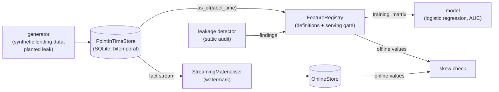

# pointintime

A bitemporal feature store in which point-in-time correctness is enforced by the read API, proved by a planted leaking feature the store refuses to serve.

[](https://github.com/Vengaiahmadineni/pointintime/actions/workflows/ci.yml)

## Why

A credit model scores 0.91 AUC offline and 0.65 in production. The cause is almost always the same: a feature was computed from data that did not exist at decision time, such as an income figure restated months after the loan decision and then joined onto it. The model learned the future, and an ordinary train/test split cannot see it.

Most feature stores offer a pleasant API and leave point-in-time correctness as a convention the caller must remember. `pointintime` makes the correct behaviour the only available one: the read API has no knowledge-time parameter, so there is nothing to forget, widen or set to `None`.

## Features

- Bitemporal fact table on SQLite: every fact has an event time and a knowledge time, and a restatement is a new row with the same `fact_id` and a later knowledge time.
- `as_of(entity, attribute, label_time)` derives the knowledge cutoff from the label time and injects it into the SQL. The deliberately named escape hatches are `audit_as_of` (explicit cutoff) and `unsafe_latest` (the leak vector, kept so the detector has something real to catch).
- Declarative feature definitions (entity, attribute, aggregation, event-time window, knowledge policy), so they can be analysed before they run.
- Static leakage detector over definitions: it decides "could this value have been known at label time?" instead of flagging features with suspiciously high AUC.
- Registry serving gate: a feature that fails the audit is quarantined and `training_matrix` refuses it with `LeakageError`.
- Streaming materialiser that replays the fact log under a watermark, with a train/serve skew check comparing offline and online values for the same entity and timestamp.
- Synthetic lending generator with a planted leak, so the leakage test has a definite pass/fail.

## Architecture



The store is the only code that touches facts, and it owns the knowledge-time predicate. The registry evaluates declarative feature definitions against the store and consults the leakage detector before a feature may be used. The online store is built by replaying facts in knowledge-time order up to a watermark, and the skew check compares it with the offline path on sampled entity-timestamps.

## Quick start

Requires Python 3.11+. The core uses only the standard library (including `sqlite3`), so there is nothing to install.

```bash
git clone https://github.com/Vengaiahmadineni/pointintime.git
cd pointintime
python -m unittest discover -s tests   # 59 tests, about 2 s
python -m src.demo                     # the leak, the refusal and the skew check, about 2 s
```

## Example

`python -m src.demo` (seed 7, 400 synthetic applicants), trimmed:

```text
[2] Offline vs production AUC (chronological 60/40 split)
  honest PIT features only       AUC 0.701
  naive latest-value join        AUC 0.912  <- offline, leaks
  same model, production inputs  AUC 0.654  <- what ships
  inflation from leak            +0.259

[3] Store refuses the leaking feature
  income_at_application        OK
  income_current_value         BLOCKED
      [CRITICAL] KNOWLEDGE_TIME_UNBOUNDED: knowledge_policy='latest' reads facts by their current value ...
      [CRITICAL] RESTATED_ATTRIBUTE_WITHOUT_PIT_BOUND: attribute 'annual_income' is declared restatable ...
  training_matrix -> LeakageError: 'income_current_value' is not a registered feature (quarantined: True)

[4] Train/serve skew: 10000 sampled entity-timestamps x 4 features
  knowledge-time watermark (correct)   mismatches     0 / 40000 (0.00%)
  event-time watermark (the bug)       mismatches  3492 / 40000 (8.73%)
```

## How it works

**Bitemporal reads.** Reading as of a knowledge time before a correction returns the original, wrong value. That property is what separates this from a table with a timestamp column and what makes backtests reproducible.

**Definitional leakage detection.** Accuracy-based detection has false negatives (a 0.03 AUC leak on a good model is invisible) and false positives (prior default count is a strong, legitimate feature). The rules instead reason about which attribute a definition touches and under which time predicates. The cost is that the detector is only as good as the attribute catalogue.

**Late events and the back door.** Replaying events in event-time order looks harmless but applies a Monday event that arrived on Friday at Monday, so a Tuesday feature contains data the system did not have yet. `materialise` replays in knowledge-time order; `materialise_by_event_time` implements the bug faithfully so its cost can be measured.

**Serving gate.** Freshness and leakage failures block serving rather than silently returning stale or future-tainted values.

Measured on the synthetic data (all produced by the commands above):

- The leak inflates offline AUC by +0.259 over what ships. Over 5 seeds (250 applicants each, run in the test suite) the offline-minus-deployed gap is 0.225 mean, SE 0.024, and deployed AUC is statistically indistinguishable from the honest model (0.715 vs 0.709).
- Skew over 10,000 entity-timestamps x 4 features: knowledge-time stream 0 / 40,000 mismatches; event-time stream 3,492 / 40,000 (8.73%), concentrated in `income_at_application` (1,570) and the 90-day transaction features (902 each).
- Mutation check: forcing the store's cutoff to "latest" fails 4/18 store tests, 4/12 streaming tests and 8/11 leak-measurement tests.

Design notes are in [docs/ARCHITECTURE.md](docs/ARCHITECTURE.md).

## Testing

```bash
python -m unittest discover -s tests -v
```

The 59 tests assert behaviour rather than mere execution:

- `test_bitemporal_store.py`: as-of reads, restatements, rejection of future-dated rows.
- `test_leakage_detector.py`: each detector rule, the quarantine path and the negative control `income_at_application`.
- `test_leak_measurement.py`: the naive join inflates offline AUC and the deployed model does not benefit.
- `test_streaming_skew.py`: offline/online parity, and late events not retroactively changing served values.

## Project layout

```text
src/
  timeline.py    ISO timestamps and day arithmetic
  store.py       bitemporal SQLite store, as_of / audit_as_of / unsafe_latest
  registry.py    feature definitions, attribute catalogue, serving gate
  leakage.py     static leakage detector
  online.py      materialisers, online store, skew and parity checks
  generator.py   synthetic lending data with the planted leak
  model.py       logistic regression and rank AUC (no dependencies)
  experiment.py  offline vs deployed AUC experiment
  demo.py        the end-to-end demo
tests/
docs/ARCHITECTURE.md
```

## Limitations

- Synthetic data only. The planted restatement gap (11,000 USD, SD 3,000) is deliberately large, so the 0.91 inflation is a property of the generator, not an estimate for real lending data.
- The detector is definitional: an attribute not marked `restatable` gets only the generic rules.
- SQLite plus an in-process replay stands in for a warehouse, Redis and Kafka: no concurrency, partitions or real network reordering. Parity is exact because both paths share the same aggregation code.
- Future-dated and knowledge-before-event rows are rejected or excluded at read and append time; the generator does not plant them in bulk (tests inject them directly).
- No HTTP service, lineage UI or deprecation workflow beyond owner fields.

## License

MIT, see [LICENSE](LICENSE).

## Maintainer

Maintained by **Vengaiah Madineni**, Data Scientist. For questions or project feedback, contact [vengaiahchowdarymadineni@gmail.com](mailto:vengaiahchowdarymadineni@gmail.com) or visit [GitHub](https://github.com/Vengaiahmadineni).