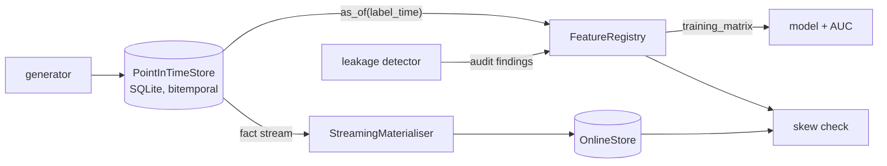

# Architecture

## Context

Models trained on features that were computed with hindsight look excellent offline and degrade in production. Feature stores usually leave point-in-time correctness to the caller. `pointintime` moves the guarantee into the store, so correct retrieval is the default and the incorrect paths are explicit, named and auditable.

## Container view

## Key decisions

**The read API has no knowledge-time parameter.** `as_of` derives the cutoff from the label time and injects it into the SQL. Alternatives such as a `timestamps=None` default were rejected because a default of "now" is a leak with a docstring. Cost: historians need a separate method, `audit_as_of`, which takes an explicit cutoff and is never used for training features.

**Restatements are new rows.** A correction has the same `fact_id` and `event_time` and a later `knowledge_time`. Reading before the correction returns the original value, which keeps backtests reproducible.

**Features are data.** `FeatureDefinition` names the attribute, aggregation, window and knowledge policy, so the detector can reason about a feature before it runs. Arbitrary Python lambdas would only allow after-the-fact heuristics.

**Definitional leakage detection over accuracy heuristics.** Suspiciously high AUC is both a false-negative and a false-positive generator. The trade-off is dependence on the attribute catalogue.

**Online store replays in knowledge-time order.** Event-time replay reintroduces leakage through late-arriving data. Both materialisers exist so the difference is measurable (0 versus 3,492 mismatches out of 40,000).

## Failure modes

- A leaking definition is quarantined at registration; `training_matrix` raises `LeakageError`.
- Future-window reads raise `FutureWindowError`; future-dated and knowledge-before-event rows are rejected or excluded.
- Online/offline disagreement is surfaced by the skew check rather than tolerated by a loose threshold.

## Out of scope

Concurrency, partitioned streaming, a network service, lineage UI and deprecation workflow. The in-process replay and SQLite are stand-ins for those pieces.
